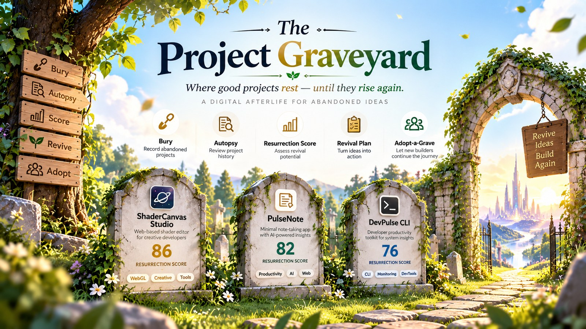

# 🪦 The Project Graveyard

**Every unfinished project deserves a second chance.**

A digital afterlife for abandoned software — built for **Baloon National Hackathon 2026, Round 2** by **Manthan Rajpurohit** (Team: Straw hat pirate),<br>
continuing the Round 1 entry *PS 05 — The Project Graveyard*.

> *"Projects rest at night, they rise at dawn."*
> Built with a serene, print-inspired **Dawn Theme** — warm ivory `#FAF6EE`, crisp cards with hairline borders `#E5DECD`, Apple-grade spring micro-interactions, Fraunces serif headlines, and gold & emerald accents. Respectful and calm: no roasts, no horror, no jokes about failure.

---

## Preview

<p align="center">
  
</p>

---

## 3-Line Problem & Solution

- **Problem:** Builders abandon projects when momentum stalls, leaving ideas, working code, and hard-earned lessons scattered across forgotten local folders and dead repos.
- **Insight:** Unfinished code shouldn't rot in guilt—stepping away gives fresh perspective, and another builder (or your future self) can bring it across the finish line.
- **Solution:** The Project Graveyard gives abandoned software an honest autopsy, computes an explainable Resurrection Score, generates an AI revival prompt, and lets community builders adopt projects with a single-line plan.

---

## How It Works

Bury → Autopsy → Resurrection Score → Choose Fate → Revival Plan → Revived

Alternative outcomes: Choose Archive to preserve a project, or mark it adoptable through Adopt-a-Grave so another builder can continue it.

---

## The Resurrection Score Formula

The Resurrection Score is a transparent, explainable heuristic (not a random number, not an opaque AI hallucination):

$$\text{Resurrection Score} = 50\% \times \text{Idea Strength} + 30\% \times \text{Completeness} + 20\% \times \text{Dormancy Bonus}$$

- **Idea Strength (0–100):** How compelling and impactful the core problem is.
- **Completeness (0–100):** How much functional UI and logic was built before work paused.
- **Dormancy Bonus (0–100):** Calculated as $10 \text{ points per month dormant}$, capped at $100$. Distance and time give a builder fresh eyes and detached clarity.

### Worked Example: *ShaderCanvas Studio*
- Idea strength: $92 \times 50\% = +46$
- Completeness: $85 \times 30\% = +26$ (rounded)
- Dormancy: $7 \text{ months} \times 10 = 70 \text{ bonus points} \times 20\% = +14$
- **Total Resurrection Score:** $46 + 26 + 14 = \mathbf{86 / 100}$

*(Seed scores stay strictly preserved across the graveyard: ShaderCanvas 86, PulseNote 82, DevPulse 76).*

---

## Features

- **Adopt-a-Grave Community Section**:
  - Dedicated section on the home page directly below the Revival Radar showcasing all claimable graves.
  - Compact cards displaying title, epitaph, score, and unfinished milestones.
  - **Adopt Flow Modal**: Requires builder name, "My plan in one line" (max 140 chars with live counter), and optional GitHub/contact handle.
  - On confirmation: transitions status to `Adopted`, logs activity feed entry, updates live stats strip, and displays `"Adopted by <name> — <plan>"` on the tombstone and inside the autopsy.
  - Empty state with a single-click action to mark dormant graves adoptable.
- **"Copy as AI Prompt" for Cursor & Claude Code**:
  - Pure function `buildRevivalPrompt(project)` generating structured, ready-to-paste Markdown including original vision, what was built, what remains unfinished, honest reason it stopped, chosen fate, markdown checklist (`[x]` / `[ ]`), and closing instruction: *"Start with the first unchecked task; keep scope small; ship a working version"*.
  - Direct clipboard copy with fallback and toast feedback.
- **Downloadable Tombstone PNG (1200×630)**:
  - Generates high-resolution social shareable tombstone card using dynamically imported `html-to-image`.
  - Arched tombstone silhouette frame, Fraunces serif typography, centered score ring, app URL, and tagline *"Rest in progress. Rise at dawn."*
  - Automatically saved as `<slug>-tombstone.png`.
- **Arched Tombstone Cards**:
  - Large top radius arched header with centered score ring.
  - Serif title, italic epitaph beneath a thin gold gradient divider rule.
  - Equal card heights with pinned footer and dedicated slot for live revival plan progress or adopter plan.
  - Subtle hover lift with soft warm gold glow (`prefers-reduced-motion` compliant).
- **Interactive Autopsy & Revival Plan**:
  - Structured records of vision, built modules, unfinished work, and the honest reason it stopped.
  - Step-by-step checklist with inline task editing, additions, deletions, and toggleable checkboxes.
  - Unchecking after reaching `Revived ✓` sensibly reverts the status and logs it once.
- **Bury from GitHub API**:
  - Paste any repository URL (supports `.git`, `/tree/main`, `/blob/...`, `www.`, or owner/repo shorthand).
  - Handles 404 with `"Repo not found or private"`.
  - On 403 rate-limit or network errors, automatically prefills the title from the repo slug so the builder can continue seamlessly.
- **Hardened Data Layer (Schema Version 2)**:
  - Versioned storage with schema migration from v1 `adoptedBy` to v2 structured `adopter` object.
  - Validated JSON export & import that never wipes existing data on invalid input and resets file inputs for repeated imports.
  - First visit and "Reset demo" provide exactly 3 dormant seeds, 0 revived, 0 adopted, and 3 activity events.

---

## Demo Flow in 90 Seconds

Follow this exact walkthrough during judging:

1. **0:00–0:15 | First Impression & Revival Radar**
   - Note the warm ivory Dawn theme (#FAF6EE),Fraunces serif headlines, and stats strip.
   - Observe the **Revival Radar** with its 6-second radial sweep highlighting **ShaderCanvas Studio** as the strongest candidate (Score: **86 / 100**).
2. **0:15–0:35 | Bury from GitHub**
   - Click **"Bury a project"** in the hero.
   - Paste a GitHub URL (e.g. `github.com/facebook/react/tree/main`).
   - Watch the repository name, description, tags, and dormancy automatically prefill. Fill in the honest reason work stopped and submit.
3. **0:35–0:50 | The Autopsy & Score Breakdown**
   - Click any card (e.g., *ShaderCanvas Studio*) to open its **Autopsy**.
   - Review what was built vs. still unfinished, plus the honest reason work stopped.
   - Inspect the **Score Breakdown**: verify the exact calculation rows (`92 × 50% = +46`, `85 × 30% = +26`, `7 mo × 10 = 70 × 20% = +14`) totaling **86 / 100**.
4. **0:50–1:05 | AI Prompt & Fate Selection**
   - In the autopsy, click **"Copy revival prompt"** &rarr; see toast confirmation. Paste it into an editor to show the generated Markdown for Cursor/Claude Code.
   - Select fate **Continue** &rarr; watch the auto-generated Revival Plan checklist appear.
5. **1:05–1:20 | Progress to "Revived ✓"**
   - Check off each milestone in the checklist.
   - As the final task is completed, observe the celebratory confetti animation and status transition to **Revived ✓**.
   - Uncheck one item to demonstrate sensible status reversion.
6. **1:20–1:30 | Community Adoption & Tombstone Download**
   - In the autopsy, click **"Download tombstone"** &rarr; downloads `shadercanvas-studio-tombstone.png` (1200×630).
   - Scroll down to the **Adopt-a-Grave** section, click **"Adopt this grave"**, enter your name and a 140-character plan &rarr; submit.
   - Watch the card update with your adopter badge, log entry, and stats strip count increment.

---

## Tech Stack & Verification

| Layer | Choice | Rationale |
|---|---|---|
| **Framework** | React 19 + Vite 8 | Instant HMR, fast builds, clean JSX |
| **Styling** | Tailwind CSS v4 | Curated Dawn palette, custom tokens, native CSS variables |
| **Animation** | Framer Motion 14 | Spring physics, fluid dialog entries, reduced-motion overrides |
| **Icons** | Lucide React | Minimalist line icons |
| **Image Generation** | html-to-image (lazy-loaded) | High-fidelity 1200×630 social tombstone graphics |
| **Testing** | Node.js Test Runner (`node --test`) | Zero-dependency, ultra-fast test suite (21/21 pass) |
| **Linter** | Oxlint | High-speed Rust-based linting (0 warnings, 0 errors) |

### Validation Commands

```bash
npm test          # 21 automated unit tests (score, utils, storage migrations)
npm run lint      # oxlint static analysis (0 warnings, 0 errors)
npm run build     # production build → dist/
```

---

## File Structure

```
src/
├── App.jsx          # UI components: Hero, Radar, TombstoneCard, AdoptAGrave, AutopsyView, Modals
├── score.js         # Resurrection Score formula & additivity-guaranteed breakdown math
├── score.test.js    # Unit tests for scoring math and integer point sum guarantees
├── storage.js       # Versioned LocalStorage layer (Schema v2) with migration & import validation
├── storage.test.js  # Storage unit tests: v1 -> v2 migration, roundtrip, corruption safety
├── utils.js         # Pure helpers: GitHub parsing, buildRevivalPrompt, plan calculations, insights
├── utils.test.js    # Unit tests for GitHub parser, prompt generator, and time formatting
├── index.css        # Dawn theme styling, custom range sliders, focus states, card glow
└── main.jsx         # App root mount
```

---

*“Every unfinished project deserves a second chance.”*
